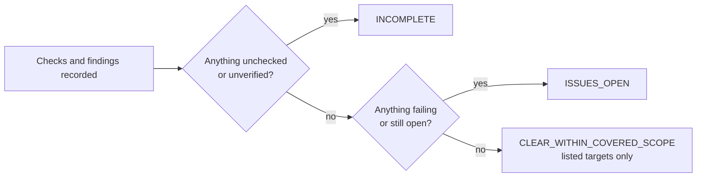
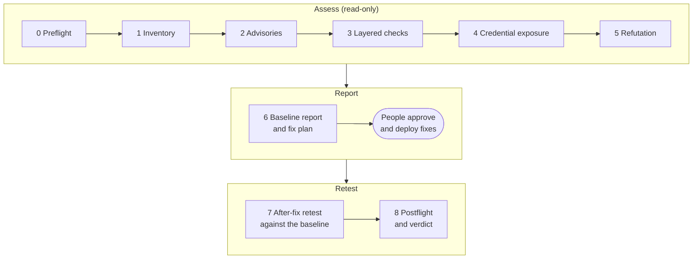
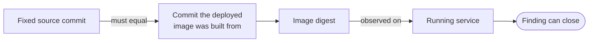

# evidence-led-security-audit

[](https://github.com/shivanathd/evidence-led-security-audit/actions/workflows/test.yml)
[](LICENSE)

An [Agent Skill](https://agentskills.io) that turns "are we affected?" into an answer backed by evidence. It guides an AI agent (Claude Code, Codex, Cursor and others that read `SKILL.md`) through a read-only security audit of systems you are allowed to assess, and makes it report what it could not check instead of calling it clean.

It was written during the October 2026 PHP remote-code-execution release and the Railway environment-variable exposure, and works for any stack.

## Why

Agent-run security checks tend to fail in the same few ways:

- `php -v` on the CLI is taken as proof of what the web server runs.
- A scanner that never ran is reported as "0 findings".
- A fix merged in git is called done before the image is deployed.
- A leaked key is "fixed" by deleting it from the repo, without rotating or revoking it.
- One model role-playing three reviewers is presented as independent review.

This skill blocks each of these with explicit rules, and ships a validator that rejects reports that break them.

## Install

```bash
npx skills add shivanathd/evidence-led-security-audit
```

Install for Claude Code only, for all your projects:

```bash
npx skills add shivanathd/evidence-led-security-audit -a claude-code -g
```

Or clone the repository into your agent's skills directory (for Claude Code, `~/.claude/skills/`). Keep the folder name `evidence-led-security-audit`.

**Requirements:** Python 3.9 or newer, standard library only. Nothing to install, no network calls. `host_checks.py` runs on macOS, Linux and Windows. The other file helpers need macOS or Linux; on other hosts they stop with `BLOCKED` instead of running with weaker checks.

## Use it

Ask your agent in plain language and name what you own:

- *"Audit our api repo and its production image for the October 21 PHP RCEs. I own both. Read-only."*
- *"Our app ran on Railway. Work out which secrets were exposed and build the rotation and revocation checklist."*
- *"I manage our Macs, Linux servers and Windows laptops. Which of them still trust the compromised eMudhra intermediates? Read-only, through our MDM."*
- *"Here's the patched build. Retest it against last week's baseline report."*
- *"Check this laptop for the October 27 briefing items: planted agent hooks, LiteLLM 1.107.0, old Node and certifi. Read-only."*

The agent then:

1. Confirms authorization, scope and which human approves what.
2. Inventories the targets and runs checks layer by layer (source, dependency, image, runtime, identity, credentials, config). Each check ends as PASS, FAIL, BLOCKED, NOT_RUN or NOT_APPLICABLE, with evidence.
3. Writes a **baseline report** (JSON and Markdown) and a fix plan with retests and rollbacks.
4. After fixes ship, writes a separate **after-fix report** that the validator compares with the baseline.
5. Gives one of three verdicts. It never says "secure".

| Verdict | Meaning |
| --- | --- |
| `INCOMPLETE` | Something required was not checked, was blocked, or a fix is not verified on the running system |
| `ISSUES_OPEN` | Coverage is complete, but a finding is open, mitigated, accepted as risk, or fixed and not deployed |
| `CLEAR_WITHIN_COVERED_SCOPE` | Nothing open, for the listed targets and checks only |

How the verdict is decided:



## How it works

`SKILL.md` is a short hub. The agent loads the detail it needs from `references/`. Every phase ends with a gate; a failed gate stops the run or records the gap as BLOCKED, never as a pass.



| Phase | What happens | Detail |
| --- | --- | --- |
| 0 Preflight | Authorization, scope, approver roles, tools | [phases.md](references/phases.md) |
| 1 Inventory | `scripts/inventory.py` lists manifests, runtime pins, SBOMs, listeners, hooks, secrets (location only) | [phases.md](references/phases.md) |
| 2 Advisories | Re-read primary sources this run, with dates. Single-source and press-only claims are leads, not proof. | [profiles/](profiles/), [phases.md](references/phases.md) |
| 3 Checks | One target and one layer per check | [scoped-checks.md](references/scoped-checks.md), [saas-identity.md](references/saas-identity.md), [endpoint-fleet.md](references/endpoint-fleet.md) |
| 4 Credential exposure | Owner, rotation, revocation, misuse review | [scoped-checks.md](references/scoped-checks.md) |
| 5 Refutation | Try to disprove every finding and every PASS | [orchestration.md](references/orchestration.md) |
| 6 Baseline report | Validate, then render | [reporting-release.md](references/reporting-release.md) |
| 7 After-fix retest | Separate report, validated against the baseline | [reporting-release.md](references/reporting-release.md) |
| 8 Postflight | Sanitize, check the package, state the gaps | [reporting-release.md](references/reporting-release.md) |

A fix only counts as closed when the fixed commit is the one the deployed image was built from, and that image digest is observed on the running service.



A tag is not a digest, and `php -v` on the CLI says nothing about the web server's runtime.

## Endpoints and fleets

For laptops and servers, [endpoint-fleet.md](references/endpoint-fleet.md) gives read-only checks for macOS, Linux distros, Windows and containers (OS build, installed packages, bundled native libraries, known-bad package versions, listening services, certificate trust stores, Java runtimes) and explains how to collect them at scale through an MDM, osquery or configuration management in check mode. Devices that don't report count as gaps, not as clean.

For the machine you are on, `scripts/host_checks.py` runs 44 read-only checks from the 16-30 Oct 2026 developer-endpoint briefings on macOS, Linux and Windows. It covers planted AI-tool hooks and 13 MB payload blobs from the testmetest worm, planted `AGENTS.md`/`CLAUDE.md` files, unexpected MCP servers and base URLs in coding-agent configs, `function-color`, LiteLLM 1.107.0, Brotli CVE-2026-111497 in Node (including `.nvmrc` / `engines.node` / CI `setup-node` pins), Python and .NET, certifi and eMudhra roots, Chrome 156, PHP2Shell, Tailscale SSH 1.104.4, PeopleSoft presence, the unconfirmed Anthropic browser/OS chain, Onamae Desktop Cloud hints, tampered Claude Code 2.1.313, Yoba fake apps, named Hugging Face cache paths (unconfirmed), Go MPTCP, TeamViewer CVE-2026-111585, Fragnesia CVE-2026-46300 and the running-kernel record for CVE-2026-98432 and more. It never runs the programs it checks. Versions come from on-disk metadata; config checks read the listed files and emit only host names and env-var names. It prints the testmetest clean-up order (clean the machine first, then revoke the token) without doing either. See [host-checks.md](references/host-checks.md) for per-OS coverage and limits. The other bundled helpers don't run on Windows, so collect other Windows evidence with PowerShell and check it elsewhere.

## Incident profiles

Profiles are dated starting points for specific incidents. They are not "latest" lists: the agent still re-reads the primary sources on every run, and a changed source wins.

| Profile | Covers | Last checked |
| --- | --- | --- |
| [php-2026-10-21.md](profiles/php-2026-10-21.md) | CVE-2026-109618 and CVE-2026-109619 (PHP RCE via OOM corruption and stale global state), plus the 2026-10-23 informational note for CVE-2026-115560: fixed builds, per-layer checks, interim measures, Unit 42 retraction | 2026-10-26 |
| [railway-2026-10-21.md](profiles/railway-2026-10-21.md) | Possible exposure of environment variables stored on Railway: inventory, rotation, revocation and misuse review | 2026-10-25 |
| [emudhra-2026-10-17.md](profiles/emudhra-2026-10-17.md) | Compromised eMudhra intermediate CA keys: which clients and trust stores still accept the chains, per OS and runtime, and how to prove they no longer do | 2026-10-25 |
| [brotli-2026-10-21.md](profiles/brotli-2026-10-21.md) | CVE-2026-111497 Brotli decoder write (Node, Bun, Python wheels, Envoy/Istio, system libbrotli): bundled copies that lockfile scanners miss; Node pins and CI `setup-node` | 2026-10-28 |
| [litellm-2026-10-21.md](profiles/litellm-2026-10-21.md) | Hijacked `litellm` wheels and images (`1.107.0`, `1.82.7`, `1.82.8`), plus the generic rule that a key committed in public is live until the provider revokes it | 2026-10-25 |
| [mesh-vpn-ssh-2026-10-25.md](profiles/mesh-vpn-ssh-2026-10-25.md) | Mesh VPN SSH and privileged forwarding (Tailscale SSH TS-2026-014..017 fixed in 1.104.4; Headscale, ZeroTier, NetBird). No CVE id | 2026-10-28 |
| [lightning-ai-2026-10-16.md](profiles/lightning-ai-2026-10-16.md) | Hosted notebook and model platforms that store provider keys (Lightning AI Studio as the dated example): rotate-and-verify-revoked | 2026-10-26 |
| [dev-endpoint-2026-10-27.md](profiles/dev-endpoint-2026-10-27.md) | Developer-endpoint briefing behind `host_checks.py`: testmetest worm, planted agent files, LiteLLM, Brotli, eMudhra, Chrome 156, PHP2Shell, Tailscale SSH, PeopleSoft, Anthropic chain (unconfirmed), Onamae Desktop Cloud, and the other "check if we use it" items | 2026-10-28 |
| [peoplesoft-2026-10-28.md](profiles/peoplesoft-2026-10-28.md) | Oracle PeopleSoft / PeopleTools footprint for CVE-2026-35273 (PeopleTools 8.61 and 8.62). Presence is review; no PIA probe | 2026-10-28 |
| [anthropic-ai-chain-2026-10-27.md](profiles/anthropic-ai-chain-2026-10-27.md) | Anthropic-published AI-discovered exploit chains (Chrome, Safari, Windows, Linux, Android). Chrome 156 dated floor; other builds unverified. Host mapping unconfirmed | 2026-10-28 |
| [gmo-onamae-2026-10-21.md](profiles/gmo-onamae-2026-10-21.md) | GMO Onamae Desktop Cloud unauthorized access: local DNS/config hints only; rotate and review if present | 2026-10-28 |
| [dev-endpoint-2026-10-30.md](profiles/dev-endpoint-2026-10-30.md) | 29–30 Oct briefing: tampered Claude Code 2.1.313, GitLab CVE-2026-97229 KEV, Yoba fake apps, Go MPTCP / CVE-2026-98432, TeamViewer CVE-2026-111585, Fragnesia CVE-2026-46300, plus leads (EMBRACE, Hugging Face miners, GitHub Actions campaign) and skipped org-level items | 2026-10-30 |
| [claude-code-vsx-2026-10-29.md](profiles/claude-code-vsx-2026-10-29.md) | Cursor Marketplace tampered `Anthropic.claude-code` 2.1.313: vendor indicators, read-only host check, no remediation | 2026-10-30 |
| [golang-mptcp-2026-10-29.md](profiles/golang-mptcp-2026-10-29.md) | Go 1.24+ MPTCP default on Linux and kernel CVE-2026-98432: no invented kernel version; running-kernel record is `linux-tcp-uaf-98432` | 2026-10-30 |
| [teamviewer-2026-10-27.md](profiles/teamviewer-2026-10-27.md) | TeamViewer CVE-2026-111585 / TV-2026-1011: 15.83 and listed legacy floors; never start TeamViewer | 2026-10-30 |
| [fragnesia-2026-10-28.md](profiles/fragnesia-2026-10-28.md) | Linux Fragnesia CVE-2026-46300 (CISA KEV): CVE-record floors plus Ubuntu release + kernel-series (HWE) table; also run `php2shell` | 2026-10-30 |
| [freebsd-wireguard-2026-07-29.md](profiles/freebsd-wireguard-2026-07-29.md) | FreeBSD-SA-26:52.if_wg / CVE-2026-58085 (confirmed July; no host_checks coverage — FreeBSD is out of that helper's OS list) | 2026-10-30 |

To add one, copy an existing profile, cite primary sources only, and name it `<topic>-<yyyy-mm-dd>.md`. See [CONTRIBUTING.md](CONTRIBUTING.md).

## Bundled scripts

The scripts check inventory and report consistency. They are not vulnerability scanners. Run these from the skill folder. `OUT` must be a canonical path, because the scripts refuse any path that contains a symlink. On macOS, `/tmp` and `/var` are symlinks, so resolve the path first:

```bash
OUT="$(cd "$(mktemp -d)" && pwd -P)"
```

<!-- tested-commands -->
```bash
python3 scripts/validate_report.py assets/examples/baseline-report.json
python3 scripts/validate_report.py assets/examples/after-fix-report.json --baseline assets/examples/baseline-report.json --public
python3 scripts/render_report.py assets/examples/baseline-report.json --out "$OUT/baseline.md"
python3 scripts/render_report.py assets/examples/after-fix-report.json --baseline assets/examples/baseline-report.json --out "$OUT/after-fix.md"
python3 scripts/inventory.py assets --target service-a-repo --out "$OUT/inventory.json"
python3 scripts/host_checks.py --root assets --only litellm-1-107-0 --out "$OUT/host-checks.json"
python3 scripts/check_public_package.py .
python3 -B -m unittest discover -s tests
```

`tests/test_public_package.py` runs every `python3` line in this block, apart from the unittest line, against a clean copy of the package.

### What each script proves and does not prove

- **`inventory.py`** reads files and lists what it finds: manifests and lockfiles (nested, test-like and vendored ones marked), Dockerfiles, listeners, PHP runtime hints (official `php` / `php-fpm` images, distro packages, composer `php` constraints), other runtime hints and pin files (including CI `setup-node`), mesh VPN hints (Tailscale / Headscale / ZeroTier / NetBird), PeopleSoft / PeopleTools path hints, Onamae Desktop Cloud / DNS config hints, SBOMs, install hooks, CI action pinning, agent instruction files, secret-shaped values and leftover artifacts.
  - It never executes repository code and never follows symlinks. It walks by directory handle, so a directory swapped mid-walk shows up as a coverage gap.
  - Secrets are reported by location only, never by value.
  - Symlinked, binary, special, oversized and excluded content (including `.git/`) makes coverage `PARTIAL`, and `--strict` exits 3. The only exception is content a human accepts with `--accept-exclusion 'PATTERN=REASON'`, which is recorded and still unscanned.
  - It knows nothing about images, running processes or CVEs.
- **`validate_report.py`** checks a report against the schema and consistency rules. Examples:
  - A PASS backed by blocked, truncated, stale or other-target evidence is rejected.
  - A missing required layer makes the verdict `INCOMPLETE`.
  - A "fixed" finding needs a before/after test or vendor-patch evidence, bound to the deployed image digest.
  - Accepted risk and undeployed fixes keep the verdict at `ISSUES_OPEN`.
  - After-fix reports need a valid `--baseline`.

  It cannot tell whether the evidence is real. `--public` adds leak rules and withholds the matched text. Without it, the validator prints `PUBLIC_SCAN_NOT_RUN`.
- **`render_report.py`** turns a valid report into Markdown, treating all report data as plain text. It redacts URL credentials, private-key blocks and token shapes, refuses reports that contain secret-shaped values, and never overwrites a file without `--force`.
- **`host_checks.py`** checks the machine it runs on for the 16-30 Oct 2026 briefing items (see [host-checks.md](references/host-checks.md)).
  - It reads files, the Windows registry and two read-only listings (`rpm -qa`, macOS `security find-certificate`). It never runs audited programs or git, and makes no network calls. The 29–30 Oct additions look for the tampered Claude Code 2.1.313 folder and named persistence files, Yoba sideload layout, named Hugging Face cache paths (unconfirmed), Go 1.24+ / `go.mod` MPTCP flags, and GitLab 19.2–19.4 version floors.
  - Config values are reduced to names and hosts and then redacted; secret values never reach the output.
  - The walk skips `node_modules` and caches, never follows symlinks, and is bounded by depth, entries and time. Anything it could not read makes the check BLOCKED or coverage PARTIAL.
  - Versions come from metadata, so a binary with false metadata is not detected.
- **`check_public_package.py`** looks for things that should not be published: secret-shaped strings, non-reserved hosts, emails, IP addresses, account-like IDs, home paths, hooks, symlinks and caches. Pass your own private terms with `--denylist` (keep that file outside the package). Extra public hosts come only from a reviewed `--host-policy` file, and any override returns `NEEDS_REVIEW`. A clean run means no rule matched; it does not prove the package is free of private data.

Host policy format (the same file works for `validate_report.py --public --host-policy`):

```json
{"approved_by_role": "publication approver",
 "hosts": [{"host": "docs.vendor.example", "rationale": "public vendor documentation cited in references"}]}
```

## Safety model

- **Read-only by default.** No exploit payloads, production probes, installs or running repository code. Active tests need owner approval and a host-enforced disposable environment.
- **People approve.** Scope, fixes, deploys, risk acceptance and publication each need a named human role. Agents draft and check; they never approve.
- **No secret values** in reports, prompts or tickets.
- **Instructions are not a sandbox.** The skill tells the agent what to do but cannot enforce it. See [SECURITY.md](SECURITY.md).

## Limits

- The machine-checked deployed-fix chain is image-based: source commit, build revision, image digest, runtime observation. For bare-metal or managed services, collect the real package and runtime evidence and report closure as incomplete; do not invent a digest to make validation pass.
- The required layers per target are a floor, not a full checklist. Add the checks the engagement needs before work starts.
- The validator enforces the inventory it is given. A reviewer still compares the report's inventory record with the raw inventory output.
- CI runs on Ubuntu (Python 3.9 and 3.14), macOS (3.14) and Windows (3.9 and 3.14). On Windows only `host_checks.py` and `validate_report.py` run; the other file helpers stop with BLOCKED. See [VALIDATION.md](VALIDATION.md).

## Repository layout

| Path | Purpose |
| --- | --- |
| `SKILL.md` | Hub the agent loads first |
| `references/` | Phases and gates, layered checks, SaaS and identity, endpoints and fleets (macOS, Linux, Windows), orchestration, tooling, reporting, CI failure modes |
| `profiles/` | Dated incident profiles |
| `assets/report.schema.json` | Report structure |
| `assets/examples/` | Synthetic baseline and after-fix reports (`service-a`, `example.invalid`) |
| `scripts/` | `inventory.py`, `validate_report.py`, `render_report.py`, `check_public_package.py`, `host_checks.py` (with `hostscan.py`) |
| `tests/` | Standard-library unit tests, simulated-host fixtures for every host check, and an adversarial corpus of 72 bad reports |
| `CHANGELOG.md` | Release notes |

## Contributing and security

Contributions are welcome: see [CONTRIBUTING.md](CONTRIBUTING.md). Report problems in the skill itself privately, as described in [SECURITY.md](SECURITY.md).

## Prior work

This is an original implementation. Ideas came from these public projects; no prompts or code were copied.

- [ECC](https://github.com/affaan-m/ECC) (MIT): role handoffs, verification loops, evals and hooks.
- [AgentShield](https://github.com/affaan-m/agentshield) (MIT): agent-configuration scanning and evidence bundles.
- [Trail of Bits skills](https://github.com/trailofbits/skills) (CC-BY-SA-4.0): false-positive checking, insecure defaults, differential review. Concepts only.
- [OSV-Scanner](https://github.com/google/osv-scanner) and [Trivy](https://github.com/aquasecurity/trivy): optional external scanners, not bundled.

Other end-to-end audit skills exist. This one does not claim to be new, complete or better.

## License

MIT. See [LICENSE](LICENSE).
